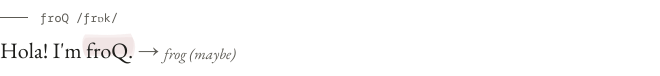
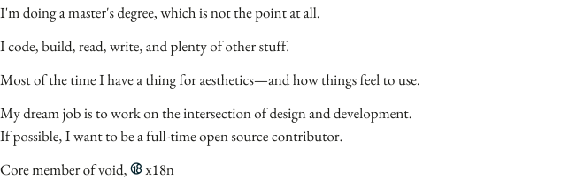
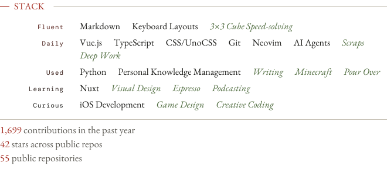
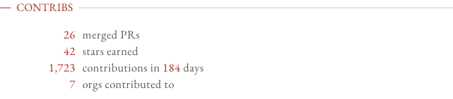
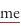
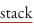

<picture>
  <source media="(prefers-color-scheme: dark)" srcset="assets/intro-dark.svg">
  
</picture>

<picture>
  <source media="(prefers-color-scheme: dark)" srcset="assets/bio-dark.svg">
  
</picture>

<picture>
  <source media="(prefers-color-scheme: dark)" srcset="assets/stack-dark.svg">
  
</picture>

<picture>
  <source media="(prefers-color-scheme: dark)" srcset="assets/contrib-dark.svg">
  
</picture>

<picture>
  <source media="(prefers-color-scheme: dark)" srcset="https://api.froq.me/now-dark.svg">
  
</picture>

<a href="https://froq.me" style="text-decoration:none;color:inherit"><picture><source media="(prefers-color-scheme: dark)" srcset="assets/nav-me-dark.svg"></picture></a><picture><source media="(prefers-color-scheme: dark)" srcset="assets/nav-dot-dark.svg"></picture><a href="https://froq.me/cv" style="text-decoration:none;color:inherit"><picture><source media="(prefers-color-scheme: dark)" srcset="assets/nav-cv-dark.svg"></picture></a><picture><source media="(prefers-color-scheme: dark)" srcset="assets/nav-dot-dark.svg"></picture><a href="https://froq.me/stack" style="text-decoration:none;color:inherit"><picture><source media="(prefers-color-scheme: dark)" srcset="assets/nav-stack-dark.svg"></picture></a><picture><source media="(prefers-color-scheme: dark)" srcset="assets/nav-dot-dark.svg"></picture><a href="https://afdian.com/a/froq-sponsor-me" style="text-decoration:none;color:inherit"><picture><source media="(prefers-color-scheme: dark)" srcset="assets/nav-afdian-dark.svg"></picture></a><picture><source media="(prefers-color-scheme: dark)" srcset="assets/nav-dot-dark.svg"></picture><a href="https://gallery.froq.me" style="text-decoration:none;color:inherit"><picture><source media="(prefers-color-scheme: dark)" srcset="assets/nav-gallery-dark.svg"></picture></a>

