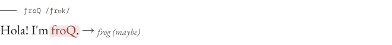
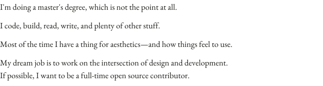
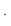

<picture>
  <source media="(prefers-color-scheme: dark)" srcset="assets/intro-dark.svg">
  
</picture>

<picture>
  <source media="(prefers-color-scheme: dark)" srcset="assets/bio-dark.svg">
  
</picture>

<picture>
  <source media="(prefers-color-scheme: dark)" srcset="assets/stack-dark.svg">
  
</picture>

<picture>
  <source media="(prefers-color-scheme: dark)" srcset="https://api.froq.me/now-dark.svg">
  
</picture>

<a href="https://froq.me"><picture>
  <source media="(prefers-color-scheme: dark)" srcset="assets/nav-me-dark.svg">
  
</picture></a><picture>
  <source media="(prefers-color-scheme: dark)" srcset="assets/nav-dot-dark.svg">
  
</picture><a href="https://froq.me/cv"><picture>
  <source media="(prefers-color-scheme: dark)" srcset="assets/nav-cv-dark.svg">
  
</picture></a><picture>
  <source media="(prefers-color-scheme: dark)" srcset="assets/nav-dot-dark.svg">
  
</picture><a href="https://froq.me/stack"><picture>
  <source media="(prefers-color-scheme: dark)" srcset="assets/nav-stack-dark.svg">
  
</picture></a><picture>
  <source media="(prefers-color-scheme: dark)" srcset="assets/nav-dot-dark.svg">
  
</picture><a href="https://afdian.com/a/froq-sponsor-me"><picture>
  <source media="(prefers-color-scheme: dark)" srcset="assets/nav-afdian-dark.svg">
  
</picture></a>

