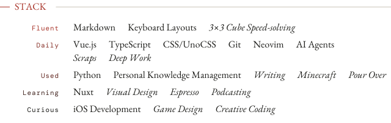

Hola! I'm froQ. → *frog (maybe)*

I'm doing a master's degree, which is not the point at all.

I code, build, read, write, and plenty of other stuff.

Most of the time I have a thing for aesthetics—and how things feel to use.

My dream job is to work on the intersection of design and development.
If possible, I want to be a full-time open source contributor.

[My CV](https://froq.me/cv) is here.

Sponsor me on [爱发电](https://afdian.com/a/froq-sponsor-me).

<picture>
  <source media="(prefers-color-scheme: dark)" srcset="assets/stack-dark.svg">
  
</picture>

Longer notes on the [stack](https://froq.me/stack).

<picture>
  <source media="(prefers-color-scheme: dark)" srcset="assets/stats-dark.svg">
  
</picture>
