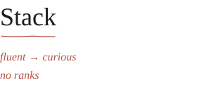
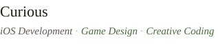

<picture>
  <source media="(prefers-color-scheme: dark)" srcset="assets/bio-dark.svg">
  
</picture>
 

<a href="https://froq.me/cv">
<picture>
  <source media="(prefers-color-scheme: dark)" srcset="assets/cv-dark.svg">
  
</picture>
</a>
 

<a href="https://afdian.com/a/froq-sponsor-me">
<picture>
  <source media="(prefers-color-scheme: dark)" srcset="assets/sponsor-dark.svg">
  
</picture>
</a>
 

<picture>
  <source media="(prefers-color-scheme: dark)" srcset="assets/rule-dark.svg">
  
</picture>
 

<picture>
  <source media="(prefers-color-scheme: dark)" srcset="assets/stack-head-dark.svg">
  
</picture>
 

<picture>
  <source media="(prefers-color-scheme: dark)" srcset="assets/stack-fluent-dark.svg">
  
</picture>

**Markdown**

I first picked up Markdown in my 1st year of university, for writing, publishing and an unhealthy fascination with PKM. Years of Obsidian, Typora, and web work later, I'm comfortable not only with the syntax itself, but also with GFM, CommonMark and the wider MD tooling ecosystem.

**Keyboard Layouts**

I stopped collecting keyboards fairly quickly after discovering split 40% layouts; the rabbit hole I stayed in was mapping. Colemak-DH, Home Row Mods, layers and combos are now muscle memory, backed by a fairly opinionated system for where keys and symbols should be.

**3×3 Cube Speed-solving**

I spent a mildly unreasonable part of my middle school years speed-solving the 3×3 cubes, with a 10s PB and 18s Ao5 at my peak. I also managed to drag most of my class into cubing for a while, which may be my earliest documented case of accidental community building.

<picture>
  <source media="(prefers-color-scheme: dark)" srcset="assets/stack-daily-dark.svg">
  
</picture>

**Vue.js**

Vue 3 was my entrance into frontend development: I found it while trying to build a personal site, before I properly knew JavaScript or HTML. Since then I've used Vue for everything from personal projects to coursework that probably shouldn't have been done in web dev.

**TypeScript**

I moved from JavaScript to TypeScript because I simply prefer software to tell me when I'm wrong. It is now the default for almost every project I start; I'm comfortable writing application code with it, while still learning how to design elegant generic and type-level APIs instead of merely satisfying the checker.

**CSS/UnoCSS**

CSS actually predates JavaScript in my own timeline: I first used SCSS to build an Obsidian theme before I started frontend development properly. These day I'm comfortable with responsive layouts, Flexbox, Grid and the usual pseudo-elements and states, while UnoCSS has become the layer I reach for most often when actually building interfaces.

**Git**

I used to do almost everything in Git manually from the CLI, including hunk-level staging and the occasional reset, revert or cherry-pick. These days I delegate more of the mechanical work to AI agents, but the workflow is still mine: atomic conventional commits, and a strong dislike of using `chore` as a drawer for changes nobody bothered to classify.

**Neovim**

I moved from VS Code to Neovim after getting tired of performance issues and moving my hands away from the home row just to navigate text. My config eventually grew into its own ecosystem, including a small plugin called `headup.nvim`; I currently write most code in Cursor for the AI layer, but Neovim is still the editing model I actually prefer.

**AI Agents**

I've watched coding with AI evolve from copying errors into ChatGPT, through Tab completion and Copilot, into agents that can operate on entire repos. I now maintain my own prompts, commands and agent instructions, and have experimented with various harnesses, multi-agent orchestration and cross-session workflows; I understand the user-facing layer much better than the internals, and that boundary is something I'm still pushing on.

**Scraps**

Scraps exist because I once designed knowledge systems so elaborate that putting information into them became work. This is the opposite: thoughts, fragments and sometime completely useless words are allowed to exist without category, a future purpose or even the expectation that I will ever read them.

**Deep Work**

I strongly prefer keeping one context loaded for hours at a time. A 6-hour session often feels cheaper than being interrupted twice; the expensive part is reconstructing the mental state after it has been evicted.

<picture>
  <source media="(prefers-color-scheme: dark)" srcset="assets/stack-used-dark.svg">
  
</picture>

**Python**

Python was the first programming language I was formally taught, and I've written enough scripts, automation and fairly substantial data-processing code with it to know that I can use it. I just rarely want to: dynamic typing, indentation-as-syntax and parts of its tooling have never matched how I like software to feel.

**Personal Knowledge Management**

I spent a large part of my first two university years trying to organise knowledge properly, eventually building an Obsidian system around atomic Notes, Concepts and higher-level Topics. The system is gone, but the lesson stayed: the more aggressively information is classified, the easier it is to flatten the context that originally gave it meaning.

**Writing**

I used to write more frequently, mostly personal and reflective essays rather than technical pieces. Woolf gave me an interest in stream-of-consciousness, Shi Tiesheng pushed me towards plainer and more restrained prose, while Camus affected the questions I ask more than the sentences I write.

**Minecraft**

I've been playing Minecraft since the 1.7 era, almost entirely in survival. I'm much more interested in building believable spaces, farming and slow modded play than in redstone,automation and competitive PvP.

**Pour Over**

I started making pour-over coffee a couple of years ago, but never turned into much of a ceremony. I grind my own beans and have settled into a brewing habit of questionable theoretical validity; fortunately, my palate is not sensitive enough to file a formal complaint.

<picture>
  <source media="(prefers-color-scheme: dark)" srcset="assets/stack-learning-dark.svg">
  
</picture>

**Nuxt**

I found Nuxt through the wider Vue ecosystem and was drawn to things like auto-imports, server APIs and Nitro long before I actually needed most of them. The personal site runs on Nuxt Content now. I'm still learning the corners I don't touch every day.

**Visual Design**

Most of what I know about visual design still comes from taste rather than formal training. I tend towards restrained colour, grayscale, serif typography and small accents, and I'm increasingly interested in turning that intuition into systems.

**Espresso**

I recently moved from occasional pour-over to making three or four espresso shots a day on a small home machine. Extraction time, ratios, distribution, tamping and milk are all still very much in the "learning what I'm doing" phase.

**Podcasting**

I started a podcast because I wanted another medium for thinking out loud, but there are not many published episodes yet. The part I already know I enjoy is expression; the craft around it-better topics, scripts, editing, guests and perhaps video-is still something I need to build deliberately.

<picture>
  <source media="(prefers-color-scheme: dark)" srcset="assets/stack-curious-dark.svg">
  
</picture>

**iOS Development**

I haven't written Swift yet. I live almost entirely inside Apple's hardware and software ecosystem, and building something native for the platforms I use every day feels less like an "if" than a "when".

**Game Design**

What interests me about games is not engines or rendering so much as rules, interactions and the behaviour they produce. I'm especially interested in how small mechanical constraints can create social dynamics, mistakes, conflict and comedy between players.

**Creative Coding**

I'm drawn to the point where code stops being infrastructure and starts producing a visual language of its own. Procedural graphics, strict pixel-based systems and generative visual elements all appeal to me, although for now I'm still much closer to experimenting with hand-drawn web details than making actual generative art.

<a href="https://froq.me/stack">
<picture>
  <source media="(prefers-color-scheme: dark)" srcset="assets/stack-link-dark.svg">
  
</picture>
</a>
 

<picture>
  <source media="(prefers-color-scheme: dark)" srcset="assets/stats-dark.svg">
  
</picture>
