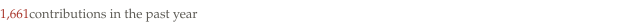

Hola! I'm froQ. → *frog (maybe)*

[froq.me](https://froq.me) · [cv](https://froq.me/cv) · [stack](https://froq.me/stack) · [爱发电](https://afdian.com/a/froq-sponsor-me)

I'm doing a master's degree, which is not the point at all.

I code, build, read, write, and plenty of other stuff.

Most of the time I have a thing for aesthetics—and how things feel to use.

My dream job is to work on the intersection of design and development.
If possible, I want to be a full-time open source contributor.

### Stack

**Fluent** — Markdown · Keyboard Layouts · *3×3 Cube Speed-solving*

**Daily** — Vue.js · TypeScript · CSS/UnoCSS · Git · Neovim · AI Agents · *Scraps* · *Deep Work*

**Used** — Python · Personal Knowledge Management · *Writing* · *Minecraft* · *Pour Over*

**Learning** — Nuxt · *Visual Design* · *Espresso* · *Podcasting*

**Curious** — iOS Development · *Game Design* · *Creative Coding*

<picture>
  <source media="(prefers-color-scheme: dark)" srcset="assets/now-dark.svg">
  
</picture>

<picture>
  <source media="(prefers-color-scheme: dark)" srcset="assets/stats-dark.svg">
  
</picture>
