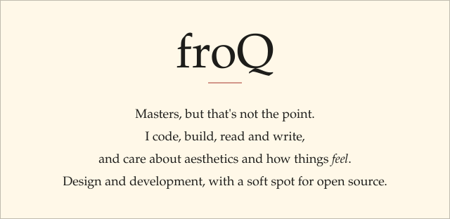

<picture>
  <source media="(prefers-color-scheme: dark)" srcset="assets/masthead-dark.svg">
  
</picture>

 

<a href="https://froq.me">froq.me</a>
&nbsp;&nbsp;·&nbsp;&nbsp;
<a href="https://gallery.froq.me">gallery</a>
&nbsp;&nbsp;·&nbsp;&nbsp;
<a href="https://froq.me/cv">cv</a>
&nbsp;&nbsp;·&nbsp;&nbsp;
<a href="https://froq.me/contact">contact</a>

 

<picture>
  <source media="(prefers-color-scheme: dark)" srcset="assets/stats-dark.svg">
  
</picture>

